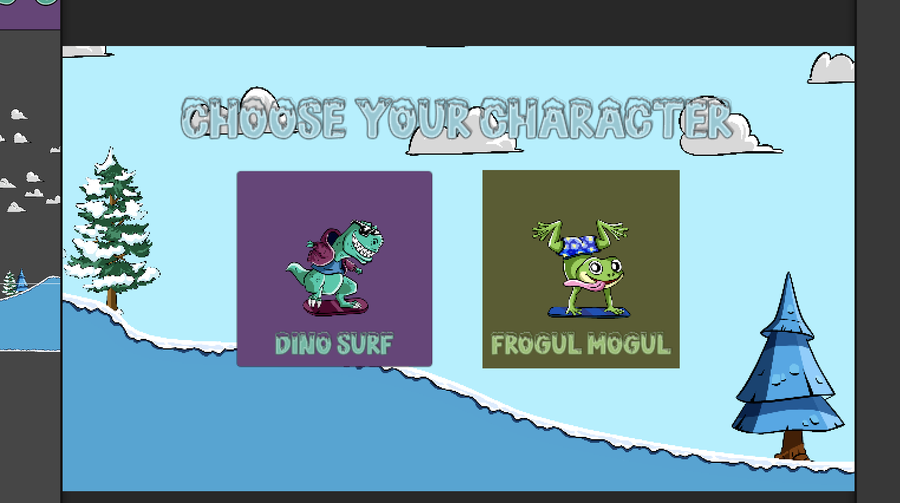
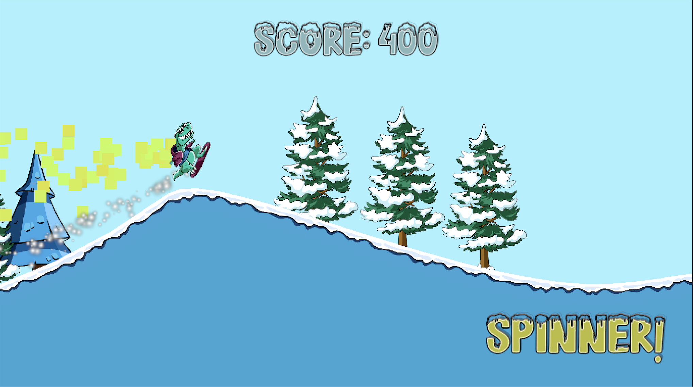

# Snow Surfer

A 2D pixel-art snowboarding game built in Unity (C#). Pick a character, slide down the slope, land flips in the air for points, grab power-ups, and reach the finish line without crashing your head into the ground.

## Gameplay

1. **Choose a character:** Dino Surf or Frogul Mogul.
2. **Slide down the slope.** The camera follows the player.
3. **Do flips in the air.** Each flip adds **100 points**.
4. **Pick up power-ups:**
   - **Torque power-up:** increases the player's torque so you can spin faster. A "SPINNER!" message shows while it is active, and it wears off after a few seconds.
   - **Speed power-up:** gives a speed boost.
5. **Reach the finish line** to win. You get a **VICTORY** message and **+1000 points**, and player control is disabled.
6. **Crash:** if the player's head touches the ground, the **GAME OVER** message appears and player control is disabled.

## Controls

| Key | Action |
|-----|--------|
| **W** | Speed up (while touching the ground) |
| **D** | Rotate clockwise |
| **A** | Rotate counter-clockwise |

## What I built

All of the game code is my own. The pixel art comes from third-party assets.

- **Character selection:** choose a character before the run starts (`CharSelectManager`)
- **Player controller:** ground-based speed control and rotation with the keyboard (`PlayerController`)
- **Flip scoring:** points are awarded for each flip in the air (`ScoreManager`)
- **Power-up system:** power-ups are defined as data with ScriptableObjects (`PowerUpSO`) and applied and timed by a manager (`PowerUpManager`)
- **Crash detection:** the head collider hitting the ground triggers game over (`CrashDetector`)
- **Finish line:** victory message, bonus score, and disabling the controls (`Finishline`)
- **Snow trail effect** behind the player (`SnowTrail`)

## Tech

- Unity 6 (6000.6.5f1), 2D
- C# for all gameplay and UI logic
- Rigidbody and colliders for physics and collision detection
- Particle systems for visual effects such as the snow trail
- Cinemachine for the camera follow
- Closed Sprite Shape for level design
- UI Layout Groups for the character select buttons
- TextMesh Pro for UI text

## Run it

1. Clone the repository.
2. Open the folder in Unity Hub with Unity 6 (6000.6.5f1).
3. Open `Assets/Scenes/SampleScene`.
4. Press **Play**.

## Credits

- Pixel art: third-party assets.
- Fonts: DirtyBrush and SNOWBLUE.
